# SDD 完整版提案 V2.0：生产级端到端流程与脚手架

> **本文件与 V1.0 的关系**：V1.0 保留在 `learning-sdd/ai4se-sdd-proposal.md`（不再修改，作为演进对照）。本文件是 **V2.0**，对齐当前代码库的 Layer 04「生产级交付」流程与脚手架实现。
>
> **提案目的**：给内部 AI4SE Council 一套**面向复杂业务的生产级端到端流程与脚手架**——覆盖 产品规划 → 需求调研 → 探索 → 原型 → 架构影响 → 需求拆分 → Story 业务面冻结 → 测试设计 → 交接 → 开发实施 → 产品验收 → 技术评审 → 分层同步 → 归档，全链路可追溯，支持研发流程从 L3（Human in the Loop）迈向 L4（Human on the Loop）。
>
> **V2.0 版本定位**：
> - **生产级（Production-Grade）**：在 V1.0 的「需求侧/交付侧两级解耦 + 分层 Sync」之上，补齐 **架构影响（OPT）**、**测试设计（MUST）** 与 **产品验收**，把「对抗审查」升级为「Review + Acceptance」双门禁。
> - **唯一流程源**：流程口径以 `docs/SOPS/SDD_WORKFLOW.md` 与 `learning-sdd/visuals/workflow-blueprint.html` 的 Layer 04 为准；需求侧 schema 为 `openspec-requirements/schemas/req-sdd.yaml` **v6**。
> - **历史对照**：轻量版 `ai4se-lightweight-sdd-proposal.md`、完整版 V1.0 `ai4se-sdd-proposal.md`。
>
> **对齐基线**：OpenSpec v2.0；`docs/SOPS/SDD_WORKFLOW.md`；`openspec-requirements/schemas/req-sdd.yaml` v6；`openspec/schemas/spec-driven.yaml`。
>
> **开源参考**：[openspec-example](https://github.com/jkang/openspec-example.git)

---

## 目录

1. [V2.0 相对 V1.0 的增量](#1-v20-相对-v10-的增量)
2. [核心挑战：从「断链」到「生产级门禁缺失」](#2-核心挑战从断链到生产级门禁缺失)
3. [方案全貌：端到端可追溯闭环](#3-方案全貌端到端可追溯闭环)
4. [核心设计与取舍](#4-核心设计与取舍)
5. [推荐脚手架配置与目录组织](#5-推荐脚手架配置与目录组织)
6. [落地指引：如何在其他业务项目中启用](#6-落地指引如何在其他业务项目中启用)
7. [延伸思考：L3/L4 成熟度定义与落地建议](#7-延伸思考l3l4-成熟度定义与落地建议)
8. [开源资源与参考](#8-开源资源与参考)

---

## 1. V2.0 相对 V1.0 的增量

| 维度 | V1.0 | V2.0 |
| :--- | :--- | :--- |
| 需求漏斗 | research → explore → prototype → storymap → story | 增加 **arch(OPT)** 与 **test-design(MUST)**，扩展为 7 步 |
| 需求侧制品 | research / idea / prototypes / storymap / story | 增加 **architecture-impact.md** 与 **test-design.md** |
| 架构影响 | 仅 `idea.md` 内联一节 | 独立 **OPT** 步骤与制品，HITL 可确认/可显式 no-op |
| 测试设计 | 隐含在开发侧 BDD 打标签 | 独立 **MUST** 步骤，产出分层用例 + 追溯矩阵，交接强制前置 |
| 交接输入 | story.md | story.md + **test-design.md**（+ architecture-impact.md） |
| 对抗审查 | qa 对抗审查 + reviewer 技术评审 | **Review + Acceptance**：qa 对抗审查 + reviewer 技术评审 + **acceptance 产品验收** |
| Sync 前门禁 | verify → review | verify → **acceptance** → review |
| 需求侧 Schema | req-sdd v5 | **req-sdd v6** |
| 交付看板漏斗 | 5 个阶段灯 | **7 个阶段灯**（调研·探索·原型·架构·拆分·故事·测试设计） |
| 角色 | lead / pm / engineer / qa / reviewer | 增加 **acceptance-runner**（验收执行者） |

> 关键原则不变：需求侧/交付侧两级解耦、分层 Sync、三目录同步、角色权威源。

---

## 2. 核心挑战：从「断链」到「生产级门禁缺失」

当业务复杂度提升（多 Epic、多 Story、跨角色协同）时，仅靠 Coding 阶段的 SDD 闭环会暴露两类问题：

**上游断链（V1.0 已解决）**
- **输入不稳定**：产品规划与路线图在上游单独管理，研发拿到的是压缩结果。
- **分析无落点**：需求分析散落在会议、IM 和 Jira 卡片里，缺少可追溯链路。
- **知识漂移**：业务文档说 A，代码实现是 B，系统沦为黑盒。
- **返工成本高**：原型未确认、边界不清，导致 Spec 从一开始就偏离真实意图。
- **规模化失控**：多 Epic/Story 并行时缺少统一漏斗、覆盖对账与基线同步。

**生产级门禁缺失（V2.0 重点解决）**
- **架构影响后置**：架构风险直到开发侧 design 才暴露，拆分与排期缺少前置依据。
- **测试设计断层**：测试分层被推迟到 `apply`，容易出现"冰淇淋蛋卷"（底层逻辑全推给 E2E）。
- **评审与验收混淆**：把"代码评审"等同于"产品验收"，用户可见结果缺少独立证据门禁。
- **交接输入不足**：只交业务 Story，开发侧拿不到可执行的分层测试契约。
- **口径漂移**：流程图标 `qa-review`，实现却是 qa/reviewer/acceptance 三个机制，文档与代码不一致。

**本提案核心：在 V1.0 的端到端闭环上，加入「架构影响（OPT）→ 测试设计（MUST）→ 产品验收 → 技术评审」的生产级门禁，把每个环节的输入/输出/责任/证据钉死；并用三目录同步与角色权威源锁死工具/角色漂移。**

---

## 3. 方案全貌：端到端可追溯闭环

### 3.1 四层架构定义

| 层级 | 核心工件 | 作用 |
| :--- | :--- | :--- |
| **Planning Baseline** | `docs/PRODUCT.md`、`docs/ROADMAP.md` | 提供方向、范围与优先级边界；**ROADMAP 按阶段组织，每阶段条目即 Epic，一阶段可含多 Epic** |
| **Business Baseline** | `docs/baseline/domain_model.html`、`business_process.html`、`service_blueprint.html`（+ `design-system/`） | 提供稳定的业务边界、流程参照与 UI 事实来源 |
| **Requirements 需求侧** | `openspec-requirements/epics/<epic-key>/`：`STATUS.md`、`research.md`、`idea.md`、`architecture-impact.md`、`analysis/`、`prototypes/`、`storymap.md`、`stories/<story-key>/story.md`、`stories/<story-key>/test-design.md` | 需求调研 → 探索 → 原型 → 架构影响(OPT) → 拆分 → Story → 测试设计(MUST)，以 Epic 为工作单元，PM 主导，**仅大块 Epic** |
| **Working Loop 交付侧** | `openspec/changes/<name>/`：`proposal.md`、`specs/`、`design.md`、`tasks.md`、`verify.md`、`review.md`、`.acceptances/<change>/report.html` | 确保实现遵循契约，先产品验收再技术评审，最后将认知沉淀回基线，Engineer 主导 |

> **横切资产**：`openspec-requirements/tools/`（需求分析工具箱，8 个 AI4PM 工具，可选增强）；`.opencode/` / `.agents/` / `.cursor/` / `.trae/`（角色定义 + 三目录同步的 skills/commands）。

### 3.2 Working Loop（生产级端到端大循环）

> 图例：节点标注 `command · skill · 产物`。需求侧命令空间 `/req:`，交付侧 `/opsx:`，规划层 `/opsx:planning:`。`+HITL` = 需人工确认，作为门禁。

```mermaid
flowchart TD
    %% ===== 基线层 =====
    A([规划基线<br/>/opsx:planning:product-vision<br/>/opsx:planning:product-planning<br/>PRODUCT.md / ROADMAP.md])
    B([业务基线<br/>/opsx:baseline/sync<br/>domain_model / business_process / service_blueprint])

    %% ===== 适用范围路由 =====
    R{适用范围路由<br/>任务类型?}

    %% ===== 需求侧 =====
    subgraph ReqSide [需求侧 · 仅大块 Epic · PM 主导]
        direction TB
        P1[需求调研 +HITL<br/>/req:research · skill: research<br/>→ research.md]
        P2[探索 +HITL<br/>/req:explore · skill: explore<br/>→ idea.md（To-Be Process/Journey + 候选 Capabilities）]
        P4{涉及 UI?}
        P5[原型（Epic 整体）+HITL<br/>/req:prototype · skill: prototype<br/>→ prototypes/*.html]
        PA[架构影响 OPT +HITL<br/>/req:arch · skill: arch-impact<br/>→ architecture-impact.md]
        P3[需求拆分 +HITL<br/>/req:storymap · skill: storymap<br/>→ storymap.md（覆盖对账）]
        P6[Story 交付 +HITL<br/>/req:story · skill: story<br/>→ stories/&lt;story-key&gt;/story.md（业务面）]
        PT[测试设计 MUST +HITL<br/>/req:test-design · skill: test-design<br/>→ test-design.md（分层用例 + 追溯矩阵）]
        T[需求分析工具箱 tools/ · 可选<br/>OSM / Process / Journey /<br/>Storymap / Narrative<br/>→ analysis/&lt;type&gt;/]
    end

    %% ===== 交接边界 =====
    subgraph Handoff [交接边界]
        H1[handoff<br/>/req:handoff · skill: handoff<br/>读 story.md + test-design.md<br/>→ 合成开发侧 proposal.md]
    end

    %% ===== 交付侧 =====
    subgraph DevSide [交付侧 · Engineer 主导]
        direction TB
        D1[提案<br/>/opsx:propose · skill: propose<br/>→ proposal.md]
        D2[行为规格<br/>/opsx:spec-design · skill: spec-design<br/>→ specs/*.md（对齐 test-design 分层）]
        D3[设计 +HITL<br/>/opsx:spec-design · skill: spec-design<br/>→ design.md + tasks.md]
        D4[实施与验证 +HITL<br/>/opsx:apply · skill: apply-change<br/>/opsx:verify · skill: verify<br/>→ 代码 + verify.md]
    end

    %% ===== 对抗审查门禁 =====
    subgraph ReviewGate [对抗审查 · Review + Acceptance · GATE]
        direction TB
        DA[产品验收 +HITL<br/>/opsx:acceptance · skill: acceptance<br/>→ .acceptances/&lt;change&gt;/report.html]
        DV[技术评审 +HITL<br/>/opsx:review · reviewer agent<br/>→ review.md（五维 P0-P3）]
    end

    %% ===== 收尾层 =====
    K1[Spec Sync · change 级<br/>/opsx:sync · skill: sync-specs<br/>→ delta specs 合并入 openspec/specs]
    L([变更归档<br/>/opsx:archive · skill: archive-change<br/>→ 归档 + epic 队列更新])
    K2[Baseline Sync +HITL · Epic 级<br/>/opsx:baseline/sync · skill: baseline/*<br/>→ 统一回流 docs/baseline + ROADMAP]
    M[周期回顾<br/>/opsx:planning:product-planning · skill: product-planning<br/>→ 更新 ROADMAP]

    %% ===== 流程连接 =====
    A ==> B
    B ==> R

    R -- 大块 Epic --> P1
    R -- Bug Fix / Tech Debt / 简单功能 --> D1

    P1 ==> P2
    P2 ==> P4
    P2 -. 可选增强 .-> T
    P3 -. 可选增强 .-> T
    P6 -. 可选增强 .-> T
    P4 -- 是 --> P5
    P4 -- 否 --> PA
    P5 --> PA
    PA --> P3
    P3 ==> P6
    P6 ==> PT
    PT ==> H1
    H1 ==> D1

    D1 ==> D2
    D2 ==> D3
    D3 ==> D4
    D4 ==> DA
    DA ==> DV
    DV ==> K1
    K1 ==> L

    L -- 该 Epic 还有下一个 Story --> P6
    L -- 该 Epic 全部 Story 已完成 --> K2
    K2 -.-> B
    K2 ==> M
    M -.-> A

    %% ===== 样式定义 =====
    classDef baseline fill:#bbdefb,stroke:#0d47a1,stroke-width:2px,color:#0d47a1
    classDef logic fill:#fff3e0,stroke:#e65100,stroke-width:2px,color:#e65100
    classDef decision fill:#e8f5e9,stroke:#2e7d32,stroke-width:2px,color:#1b5e20
    classDef impl fill:#f3e5f5,stroke:#7b1fa2,stroke-width:2px,color:#4a148c
    classDef gate fill:#fce4ec,stroke:#ad1457,stroke-width:2px,color:#880e4f
    classDef archive fill:#f5f5f5,stroke:#9e9e9e,stroke-width:2px,color:#616161
    classDef optional fill:#fffde7,stroke:#f9a825,stroke-width:1.5px,stroke-dasharray: 4 3,color:#f57f17

    class A,B baseline
    class R,P4 decision
    class P1,P2,P3,P5,P6,PA,PT,H1,K1,K2 logic
    class D1 logic
    class D2,D3,D4 impl
    class DA,DV gate
    class L,M archive
    class T optional

    style ReqSide fill:#e8f5e9,stroke:#2e7d32,stroke-dasharray: 5 5
    style Handoff fill:#fff8e1,stroke:#f57f17,stroke-dasharray: 5 5
    style DevSide fill:#f3e5f5,stroke:#7b1fa2,stroke-dasharray: 5 5
    style ReviewGate fill:#fce4ec,stroke:#ad1457,stroke-dasharray: 5 5
```



### 3.3 节点 × 命令 × Skill × 产物 对照表

| 节点 | 环节 | 命令 | Skill / Agent | 产物 | 主导 | 门禁 |
| --- | --- | --- | --- | --- | --- | --- |
| A | 规划基线 | `/opsx:planning:product-vision` / `product-planning` | `product-vision` / `product-planning` | `docs/PRODUCT.md` / `docs/ROADMAP.md` | PM | — |
| B | 业务基线 | `/opsx:baseline/sync` | `blueprint` / `domain-model` / `process-flow` / `render` | baseline 三件套（+ `design-system/`） | PM/Lead | — |
| R | 适用范围路由 | 决策点 | — | Epic→需求侧；其余→交付侧 | Lead | — |
| P1 | 需求调研 | `/req:research` | `research` | `research.md`（单 Epic） | PM | HITL |
| P2 | 探索 | `/req:explore` | `explore` | `idea.md`（To-Be + 候选 Capabilities） | PM | HITL |
| P4 | UI 决策 | 决策点 | — | — | PM | — |
| P5 | 原型（Epic 整体） | `/req:prototype` | `prototype` | `prototypes/*.html`（复杂业务 → `working/`） | PM | HITL · IF UI |
| PA | 架构影响 | `/req:arch` | `arch-impact` | `architecture-impact.md` | PM/Lead | HITL · **OPT** |
| P3 | 需求拆分 | `/req:storymap` | `storymap` | `storymap.md`（覆盖对账） | PM | HITL |
| P6 | Story 交付 | `/req:story` | `story` | `stories/<story-key>/story.md`（业务面） | PM | HITL |
| PT | 测试设计 | `/req:test-design` | `test-design` | `stories/<story-key>/test-design.md`（分层用例+追溯矩阵） | PM/QA | HITL · **MUST** |
| T | 可选分析增强 | 阶段 skill 编排 `tools/` | `tools/*`（8 个 AI4PM 工具） | `analysis/{osm,process,journey,storymap,narrative}/` | PM | — |
| H1 | 交接 | `/req:handoff` | `handoff` | 合成 `proposal.md` + 登记 `epic-<key>.story-list.json` | Lead/PM | **MUST** |
| D1 | 提案 | `/opsx:propose` | `propose` | `proposal.md` | Engineer | — |
| D2 | 行为规格 | `/opsx:spec-design` | `spec-design` | `specs/*.md`（Story-specs，对齐 test-design） | Engineer | — |
| D3 | 设计 | `/opsx:spec-design` | `spec-design` | `design.md` + `tasks.md` | Engineer | HITL |
| D4 | 实施与验证 | `/opsx:apply` → `/opsx:verify` | `apply-change` / `verify` | 代码 + `verify.md` | Engineer | HITL |
| DA | 产品验收 | `/opsx:acceptance` | `acceptance` + `acceptance-runner` | `.acceptances/<change>/report.html` | QA / acceptance-runner | HITL · **GATE** |
| DV | 技术评审 | `/opsx:review` | `reviewer` agent | `review.md`（五维 P0-P3 + 修复计划） | Reviewer | HITL · **GATE** |
| K1 | Spec Sync（change 级） | `/opsx:sync` | `sync-specs` | delta→`openspec/specs` | Lead | — |
| L | 归档 | `/opsx:archive` | `archive-change` | 归档 + epic 队列更新 | Lead | **MUST** |
| K2 | Baseline Sync（Epic 级） | `/opsx:baseline/sync` | `baseline/*` | 统一回流 `docs/baseline/*.html` | Lead | HITL · **EPIC** |
| M | 周期回顾 | `/opsx:planning:product-planning` | `product-planning` | 更新 `docs/ROADMAP.md` | PM | — |

> **门禁口径（对齐 Layer 04）**：12 MUST · 1 IF UI · 1 OPT · 1 EPIC；8 HITL · 5 AUTO · 1 Review Gate。

---

## 4. 核心设计与取舍

### 4.1 需求侧 / 交付侧两级解耦

- **需求侧**（`openspec-requirements/`，PM 主导，**仅大块 Epic**）：规划在起点已有（ROADMAP 每阶段多 Epic），需求侧针对单个 Epic 做 **调研 → 探索 → 原型 → 架构影响(OPT) → 拆分 → Story → 测试设计(MUST)**，并用 `STATUS.md` 维护生命周期。
- **交付侧**（`openspec/changes/`，Engineer 主导）：从 `proposal` 起步（handoff 合成或直走），按 capability 拆分行为规格 specs，不再重复需求侧阶段。

### 4.2 适用范围路由

- **大块 Epic** → 需求侧漏斗（7 步）→ `/req:handoff` → 交付侧。
- **Bug Fix / Tech Debt / 简单功能修改** → 直走交付侧（`/opsx:propose` 起），不走需求漏斗；架构影响内联 `proposal.md`，不单独执行 `/req:arch`。

### 4.3 需求漏斗各环节（含可选分析工具箱）

| 环节 | skill | 产物 | 要点 |
| --- | --- | --- | --- |
| ① 需求调研 | `research` | `research.md` | 针对单个 Epic：背景/干系人/访谈原始记录/约束/疑问/结论；先调研→识别 Epic→创建目录 |
| ② 探索 | `explore` | `idea.md` | 调研→产品设计思路；含 To-Be Process/Journey；识别候选 Capabilities（对齐 domain_model） |
| ③ 原型（Epic 整体） | `prototype` | `prototypes/*.html` | 拆分前对 Epic 整体做一次；复杂业务走 `prototype-generator` → `working/`；HITL |
| ④ 架构影响（OPT） | `arch-impact` | `architecture-impact.md` | 评估 BC/Capability、四层架构、数据、渠道同源、API、安全、非功能、迁移；无影响显式 no-op；HITL |
| ⑤ 需求拆分 | `storymap` | `storymap.md` | 覆盖对账（Epic 每承诺项必有 Story 承接）；粒度=完整端到端功能 |
| ⑥ Story 交付 | `story` | `stories/<story-key>/story.md` | 业务面冻结交付物（场景/规则/E2E/治理映射） |
| ⑦ 测试设计（MUST） | `test-design` | `stories/<story-key>/test-design.md` | 分层用例（@unit/@api/@e2e）+ 追溯矩阵；交接强制前置；HITL |
| （可选）分析增强 | 阶段 skill 编排 `tools/` | `analysis/<type>/` | OSM / Process / Journey / Storymap / Narrative，全部 optional |

> **架构影响（OPT）设计要点**：只在需求侧 Epic 漏斗执行；直走交付侧任务的架构影响内联 `proposal.md`。制品必须引用真实基线节点（`bc-*` / `cap-*` / `L1/L2/L3` / `SB-*`）；无实质影响时**显式记录 no-op 及理由**，不得静默跳过。
>
> **测试设计（MUST）设计要点**：遵循 `docs/TESTING_STRATEGY.md` 测试金字塔（`@unit` ~70% / `@api` ~20% / `@e2e` ~10%）；每个 Story E2E 场景必须映射到 ≥1 个分层用例；E2E 步骤按 Story 分文件、带领域/角色前缀（防 ambiguous）；只做设计，不写测试代码、不生成 specs。

### 4.4 交接边界（handoff）

- 读取 `story.md`（业务面）与 `test-design.md`（分层测试设计）；`architecture-impact.md`（若存在）作为 Impact 优先依据。
- 开发侧 `openspec new change` → **合成 `proposal.md`**（Capabilities ← idea 候选 capabilities；Process/Blueprint Alignment ← 治理映射；Impact ← architecture-impact.md / idea）。
- **`test-design.md` 是交接强制前置**；缺失或未 HITL 确认时禁止 handoff。
- 同时**登记 Epic 队列** `openspec/epic-<key>.story-list.json`（status=`in_progress`，记录 `changeName`），回填需求侧 `STATUS.md`（Story → handoff）。
- 需求侧不生成 specs/；行为规格由开发侧按 capability 拆分生成，标签与分层必须对齐 `test-design.md` 的追溯矩阵。

### 4.5 对抗审查：Review + Acceptance（V2.0 关键升级）

Layer 04 的「对抗审查」是一个 **GATE**，由三个互补机制组成，互不替代：

| 机制 | 执行者 | 关注点 | 产物 | 命令 |
| --- | --- | --- | --- | --- |
| **qa 对抗审查** | `qa` agent | 制品一致性 / 幻觉 / 可测试性 / 治理映射（PASS/WARN/FAIL） | 报告/门禁结论 | 随流程执行 |
| **产品验收** | `qa` 计划门禁 + `acceptance-runner` 执行 | 用户可见结果是否正确、证据是否充分 | `.acceptances/<change>/report.html` | `/opsx:acceptance` |
| **技术评审** | `reviewer` agent | 架构合理性/技术架构/业务领域/安全/质量（P0-P3） | `review.md` | `/opsx:review` |

- **顺序**：`verify` 之后、`review` 之前执行产品验收（涉及用户可见行为时）；纯文档/纯重构可显式跳过并说明原因。
- **门禁**：验收不通过或存在 P0 / 未获书面风险接受的 P1 → 禁止 `sync` / `archive`。
- **口径澄清**：不存在独立的 `qa-review` skill；图中的「对抗审查」即上述三者组合。

### 4.6 分层 Sync（关键取舍）

- **Spec Sync（change 级）**：每个 Story 归档前，delta specs 合并入 `openspec/specs/`。
- **Baseline Sync（Epic 级）**：**Epic 所有 Story 归档后**，统一回流 `docs/baseline/*.html` + Roadmap 判定，并执行**显式 No-op 判定**（无变化也须记录理由，防基线腐蚀）。

### 4.7 命名与目录约定

- **skill 按域子目录组织**：`prod/`（产品/需求侧）、`opsx/`（交付侧）、`baseline/`（业务基线）；`acceptance` 为跨侧根级 skill。
- **需求侧 skill 名**不带前缀：`research` / `explore` / `prototype` / `arch-impact` / `storymap` / `story` / `test-design` / `handoff`（+ 产品侧 `product-vision` / `product-planning` / `delivery-board`）。
- **交付侧 skill 名**去 `openspec-` 前缀：`propose` / `spec-design` / `apply-change` / `verify` / `sync-specs` / `archive-change` / `update-change` / `prototype`。
- **baseline skill 去 `openspec-baseline-` 前缀**：`blueprint` / `domain-model` / `process-flow` / `render`。
- **命令用命名空间子目录**：需求侧 `/req:`（`commands/req/`，含 `arch`、`test-design`），交付侧 `/opsx:`（`commands/opsx/`，含 `acceptance`、`review`）。
- **角色定义**：权威源在 `.opencode/agents/`（`lead`/`pm`/`engineer`/`qa`/`reviewer`/`acceptance-runner`），`.cursor/agents/` 为格式适配副本（两处同步）。
- **三目录同步硬约束**：对 SDD 工作流（skills/commands）的任何修改必须同步 `.agents/`、`.trae/`、`.cursor/`（AGENTS.md 硬约束）。
- **工具箱不重复**：`openspec-requirements/tools/` 为需求分析工具唯一事实来源，不三目录重复拷贝。

### 4.8 完整但不臃肿（Complexity-Balanced）

面向复杂业务，治理力度随复杂度自适应：需求侧覆盖需求工程全链路（含架构影响与测试设计），交付侧聚焦契约落地，分层 Sync 只在 Epic 收尾统一执行。OPT 步骤可显式跳过、可选分析全部 optional——**完整覆盖生产级场景，但不陷入文档量膨胀与过度治理**。

---

## 5. 推荐脚手架配置与目录组织

### 5.1 目录组织全景图

```text
OpenSpec-practice/
├── .opencode/
│   ├── agents/                    # 角色权威源：lead / pm / engineer / qa / reviewer / acceptance-runner
│   ├── commands/                  # opencode 内置引导命令
│   └── skills/                    # opencode 基建技能
├── .agents/                       # 跨工具通用 Agent 资产（三目录同步基准）
│   ├── commands/
│   │   ├── req/                   # /req:*（research/explore/prototype/arch/storymap/story/test-design/handoff）
│   │   └── opsx/                  # /opsx:*（propose/spec-design/apply/verify/acceptance/review/sync/archive/update/prototype
│   │                              #          + planning/ + governance/ + baseline/）
│   └── skills/
│       ├── acceptance/            # 产品验收（跨侧根级 skill）
│       ├── prod/                  # research/explore/prototype/arch-impact/storymap/story/test-design/handoff
│       │                          # + product-vision/product-planning/delivery-board
│       ├── opsx/                  # propose/spec-design/apply-change/verify/sync-specs/archive-change/update-change/prototype
│       └── baseline/              # blueprint/domain-model/process-flow/render
├── .cursor/                       # Cursor 适配副本（结构同 .agents + agents/ 角色副本）
├── .trae/                         # Trae 适配副本（结构同 .agents）
├── openspec/                      # 交付侧引擎工作区（schema: spec-driven）
│   ├── schemas/spec-driven.yaml
│   ├── templates/
│   ├── specs/                     # 主规格沉淀区
│   ├── changes/                   # 活跃 change（proposal/specs/design/tasks/verify/review）
│   │   └── archive/
│   └── epic-<key>.story-list.json # Epic 跨 change 编排队列
├── openspec-requirements/         # 需求侧工作区（schema: req-sdd v6）
│   ├── config.yaml
│   ├── schemas/req-sdd.yaml       # research→explore→prototype→arch(OPT)→storymap→story→test-design(MUST)→handoff
│   ├── templates/                 # research/idea/prototype/architecture-impact/storymap/story/test-design/STATUS
│   ├── tools/                     # 8 个 AI4PM 工具（单份自包含）
│   ├── epics/<epic-key>/
│   │   ├── STATUS.md              # 生命周期唯一状态源（含 arch / test-design 阶段）
│   │   ├── research.md            # ① 调研
│   │   ├── idea.md                # ② 探索（To-Be + 候选 Capabilities）
│   │   ├── architecture-impact.md # ④ 架构影响（OPT）
│   │   ├── analysis/              # 可选分析制品
│   │   ├── prototypes/            # ③ Epic 整体原型
│   │   ├── storymap.md            # ⑤ 拆分（覆盖对账）
│   │   └── stories/<story-key>/
│   │       ├── story.md           # ⑥ 业务面冻结交付物
│   │       └── test-design.md     # ⑦ 分层测试设计（MUST）
│   └── archive/YYYY-MM-DD-<epic-key>/
├── docs/
│   ├── SOPS/SDD_WORKFLOW.md
│   ├── PRODUCT.md / ROADMAP.md
│   ├── FRONTEND.md / ARCHITECTURE.md / TESTING_STRATEGY.md / QUALITY_SCORE.md
│   ├── governance/delivery_board.html     # 需求漏斗 7 灯
│   └── baseline/
├── e2e-tests/
├── ecommerce/
├── learning-sdd/
├── scripts/
│   ├── migrate-scaffold.sh
│   └── generate_delivery_board.py
└── init.sh
```

### 5.2 基础脚手架部分（直接复用）

- **护栏与指令集**：`.agents/`、`.cursor/`、`.trae/` 下**各含** `/opsx:*` 与 `/req:*` 指令与 skills；**三目录必须同步**。
- **角色定义**：`.opencode/agents/`（权威）+ `.cursor/agents/`（适配副本）；两处同步。
- **需求分析工具箱**：`openspec-requirements/tools/`（8 个 AI4PM 工具，单份自包含）。
- **流程定义**：`docs/SOPS/SDD_WORKFLOW.md`。
- **产物模板**：需求侧 `openspec-requirements/templates/`，交付侧 `openspec/templates/`。
- **迁移工具**：`scripts/migrate-scaffold.sh`。

---

## 6. 落地指引：如何在其他业务项目中启用

> **两条启用路径**：
> - **新项目直接上生产级**：按下方 6.1-6.5 全量启用。
> - **从 V1.0 演进**：先保留原有闭环；增量启用 ① `arch-impact`（OPT）② `test-design`（MUST）③ `/opsx:acceptance` 产品验收与「Review + Acceptance」门禁 ④ 需求侧 schema 升级到 v6、看板漏斗扩到 7 灯。

### 6.1 第一步：引入基础引擎与初始化结构
1. **执行迁移脚本**：`./scripts/migrate-scaffold.sh <目标项目绝对路径>`——拷贝 `.opencode/`、`.agents/`、`.cursor/`、`.trae/`、`openspec/`、`openspec-requirements/` 以及 `docs/` 模板。
2. **重构 Config**：修改 `openspec/config.yaml` 与 `openspec-requirements/config.yaml` 的项目背景与规则。

### 6.2 第二步：初始化业务基线
1. **录入规划**：修改 `docs/PRODUCT.md` 与 `docs/ROADMAP.md`（每阶段条目即 Epic）。
2. **重构规范**：按需修改 `docs/ARCHITECTURE.md`、`docs/FRONTEND.md`、`docs/TESTING_STRATEGY.md`。
3. **初始化基线 HTML**：在 `docs/baseline/` 录入真实边界与流程；首个 UI Epic 前用 `brand-design-system` 生成 `design-system/`。

### 6.3 第三步：执行首个 Epic 闭环（需求侧 7 步）
1. **需求调研**：`/req:research` → `research.md`（HITL）。
2. **探索**：`/req:explore` → `idea.md`（To-Be + 候选 Capabilities，HITL）；可选 `tools/` 生成 `analysis/`。
3. **原型**：`/req:prototype` → Epic 整体原型（HITL）。
4. **架构影响（OPT）**：`/req:arch` → `architecture-impact.md`（HITL；无影响显式 no-op）。
5. **拆分**：`/req:storymap` → `storymap.md`（覆盖对账，HITL）。
6. **Story**：`/req:story` → `story.md`（业务面，HITL）。
7. **测试设计（MUST）**：`/req:test-design` → `test-design.md`（分层用例 + 追溯矩阵，HITL）。

### 6.4 第四步：交接与交付侧闭环
1. **交接**：`/req:handoff` 合成开发侧 proposal（读 story + test-design），并登记 `epic-<key>.story-list.json`。
2. **规格驱动**：`/opsx:spec-design` → `/opsx:apply` → `/opsx:verify`（Gherkin 标签与分层对齐 test-design）。
3. **产品验收**：`/opsx:acceptance`（涉及用户可见行为时），产出本地验收报告。
4. **技术评审**：`/opsx:review`，输出五维 P0-P3；存在阻断项时禁止 sync/archive。
5. **Spec Sync（change 级）**：`/opsx:sync` 合并 delta→主规格。
6. **归档**：`/opsx:archive`；循环下一个 Story 或进入 Epic 收尾。
7. **Baseline Sync（Epic 级）**：`/opsx:baseline/sync` 统一回流基线（含显式 No-op 判定）；`/opsx:planning:product-planning` 更新 ROADMAP。

### 6.5 第五步：建立生产级门禁与度量
- **门禁矩阵**：MUST（12）/ IF UI（1）/ OPT（1）/ EPIC（1）；HITL（8）；Review Gate（1）。
- **可视化**：`python3 scripts/generate_delivery_board.py` 生成 `docs/governance/delivery_board.html`（需求漏斗 7 灯 + 质量信号）。
- **一致性审计**：定期对比 `.agents/`、`.trae/`、`.cursor/` 的 skills/commands 是否同步；`.opencode/agents/` 与 `.cursor/agents/` 角色是否一致。

---

## 7. 延伸思考：L3/L4 成熟度定义与落地建议

### 7.1 L3：Human in the Loop
- **特点**：人工确认是关键门禁，AI 不能跳过确认断点。
- **基础门禁**：需求调研确认、探索确认、原型确认、架构影响确认(OPT)、拆分确认、Story 验收确认、测试设计确认、产品验收计划确认、技术评审 P0/P1 风险裁决、Baseline Sync 确认。

### 7.2 L4：Human on the Loop
- **特点**：AI 在明确护栏（Baseline、门禁策略）内自治，人负责监督与异常裁决。
- **核心支撑**：稳定的 Baseline、明确的任务分类、可量化的测试设计（追溯矩阵）、可视化的运行看板（`docs/governance/delivery_board.html`）。

### 7.3 阶段性落地建议
1. **统一最小制品**：不追求文档量，追求「需求不返工、输出稳定」。
2. **站稳 Story + 测试设计**：先落实业务评审门禁与分层测试契约，解决需求跳步与测试后置。
3. **用验收与评审分离**：产品验收判「用户看到的是否正确」，技术评审判「设计/实现是否可靠」，二者不可互相替代。
4. **分层 Sync 驱动基线**：change 级保 specs 连续，Epic 级保 baseline 稳定（显式 No-op 防腐蚀）。

---

> **核心总结**：面向复杂业务，建立一条 AI 和团队都能稳定执行的 **生产级知识闭环**——需求侧从调研到测试设计（research → explore → prototype → arch(OPT) → storymap → story → test-design(MUST)），交付侧从 proposal 到归档（propose → specs → design → apply/verify → acceptance → review → Spec Sync → archive），中间用 handoff 与分层 Sync（Epic 级 Baseline）咬合；并以三目录同步与角色权威源锁死工具/角色漂移。V1.0 见 `ai4se-sdd-proposal.md`（保留作演进对照）。

---

## 8. 开源资源与参考

- **OpenSpec 示例项目**：[https://github.com/jkang/openspec-example.git](https://github.com/jkang/openspec-example.git)
- **完整版 V1.0（保留）**：`learning-sdd/ai4se-sdd-proposal.md`
- **轻量版提案（历史快照）**：`learning-sdd/ai4se-lightweight-sdd-proposal.md`
- **SDD 工作流 SOP（当前权威）**：`docs/SOPS/SDD_WORKFLOW.md`
- **需求侧工作区说明**：`openspec-requirements/README.md`
- **需求分析工具箱**：`openspec-requirements/tools/README.md`
- **Schema（唯一事实来源）**：`openspec/schemas/spec-driven.yaml`、`openspec-requirements/schemas/req-sdd.yaml`（v6）
- **生产级流程可视化**：`learning-sdd/visuals/workflow-blueprint.html`（Layer 04）
